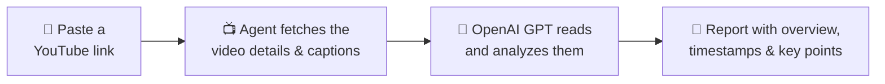

<h1 align="center">🎥 YouTube Video Analyzer</h1>

<p align="center">
  <b>Paste a YouTube link and get a clear, timestamped summary of the whole video.</b>
</p>

<p align="center">
  
  
  
  
  
</p>

<p align="center">
  
</p>

Long videos take time to watch. **YouTube Video Analyzer** reads a video's captions for you and turns them into a short report: what the video is about, where each part starts, and the points worth remembering. Use it to decide whether a video is worth your time, jump straight to the part you need, or turn a lecture into study notes.

## ✨ Features

- 🧭 **Quick overview**: what kind of video it is (tutorial, review, lecture …) and how it's organized
- ⏱️ **Timestamps**: where each topic starts and ends, with a short summary of each part
- 🗂️ **Main themes**: related parts grouped together, so you can see how the topics build on each other
- 💡 **Key points**: the main lessons, demos and references worth remembering
- 🏷️ **Content tags**: 📚 Educational · 💻 Technical · 🎮 Gaming · 📱 Tech Review · 🎨 Creative
- 🖱️ **Easy to use**: one web page with one box and one button

<details>
<summary><b>👀 See an example report</b></summary>

<br>

> *An illustration of the layout. Real reports depend on the video.*
>
> **📚 Overview:** a beginner tutorial on building a to-do list app, in four parts.
>
> **⏱️ Timestamps**
> - **0:00 – 1:30** · Introduction: what you'll build and what you need
> - **1:30 – 6:45** · Setting up the project
> - **6:45 – 14:10** · Adding, completing and deleting tasks, with a live demo
> - **14:10 – 18:00** · Recap, common mistakes and next steps
>
> **💡 Key points:** keep the data separate from the screen code, and test each feature as soon as you build it.

</details>

## ⚙️ How it works



The web page is built with [Streamlit](https://streamlit.io/). Behind it, an AI agent made with [Agno](https://github.com/agno-agi/agno) uses YouTube tools to get the video's title, channel and captions, including when each line is spoken. An OpenAI GPT model then writes the report. No YouTube account or YouTube API key is needed.

## 🚀 Getting started

You'll need **Python 3.10 or newer** and an **OpenAI API key** ([create one here](https://platform.openai.com/api-keys)).

**1. Download the project**

```bash
git clone https://github.com/Preetbbhalala/Youtube-Video-Analyzer.git
cd Youtube-Video-Analyzer
```

**2. Install the packages**

```bash
pip install "agno<3" openai youtube-transcript-api streamlit python-dotenv
```

**3. Add your API key.** Create a file named `.env` in the project folder containing the line below. Keep this file private and don't upload it to GitHub.

```text
OPENAI_API_KEY=your-openai-api-key
```

**4. Start the app**

```bash
streamlit run ui.py
```

It opens in your browser at `http://localhost:8501`. Paste a link, click **Analyze Video**, and the report appears in a few moments.

## 🗂️ Project files

| File | What it does |
|---|---|
| `ui.py` | The web app: the link box, the **Analyze Video** button and the report |
| `youtube_analyzer.py` | The YouTube agent: its AI model, its YouTube tools and the instructions that shape the report |
| `agent.py` | Practice example: a travel assistant that searches the web with DuckDuckGo |
| `finance.py` | Practice example: a stock analyst that uses Yahoo Finance data and web search |
| `memory.py` | Practice example: an assistant that remembers facts about you across messages |
| `team.py` | Practice example: a team of three agents that answer in English, Chinese and Hindi |

The practice examples are small Agno experiments that run in the terminal, for example `python team.py`. They use the `qwen/qwen3-32b` model on [Groq](https://console.groq.com/keys), so they need a `GROQ_API_KEY=...` line in `.env` and a few extra packages:

```bash
pip install groq ddgs yfinance "sqlalchemy[asyncio]"
```

## 💡 Good to know

- **The video needs English captions.** Auto-generated captions work too, but videos without any can't be analyzed.
- **Use a standard video link**, such as `youtube.com/watch?v=…` or `youtu.be/…`. Shorts links (`youtube.com/shorts/…`) aren't recognized.
- **Each analysis uses your OpenAI API key**, so it's billed to your OpenAI account. To try another model, change `gpt-5.2` in `youtube_analyzer.py`.
- **Running it on a cloud server?** YouTube often blocks caption requests from cloud providers, so the app works best on your own computer.
- **Why `agno<3`?** The code is written for Agno 2, and Agno 3 renamed some options that `memory.py` uses.
- **The report is AI-generated.** It's a quick guide to the video, so double-check any details that matter.

## 🛠️ Built with

[Agno](https://github.com/agno-agi/agno) (AI agent) · [OpenAI](https://platform.openai.com/) (GPT model) · [youtube-transcript-api](https://github.com/jdepoix/youtube-transcript-api) (captions) · [Streamlit](https://streamlit.io/) (web app) · [python-dotenv](https://github.com/theskumar/python-dotenv) (API keys)

## 👤 Author

Made by [@Preetbbhalala](https://github.com/Preetbbhalala). If this project helps you, consider giving it a ⭐
